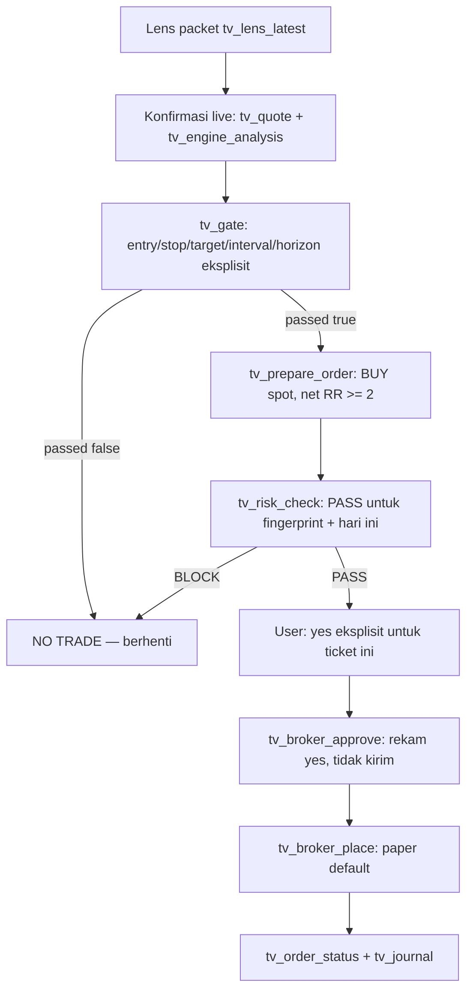

# CHECKPOINT — Memakai agen omp (AI Agent Lens → Tokocrypto) setelah install ulang

Ini **titik pulih**. Jika Termux, app Analisa Pasar, atau lingkungan omp di-install ulang: **tool, skill, skrip, dan runbook ada di repo ini**. Cukup pull + `restore.sh`, lalu ikuti langkah di bawah. Tidak perlu riset/porting ulang.

## 0. Apa yang disimpan repo ini

| Kebutuhan | Sumber di repo | Tujuan di perangkat |
|---|---|---|
| Receiver webhook Lens + MCP server + helper | `tools/omp-tv-adapter/tv-adapter/` | `~/trader/tv-adapter/` |
| Skill runtime gate/risk/broker + lib pasar | `tools/omp-tv-adapter/agent-skills/` | `~/.agents/skills/` |
| Skill omp (managed) | `agent-skills/tv-lens-tokocrypto-adapter/SKILL.md` | `~/.omp/agent/managed-skills/.../SKILL.md` |
| Registrasi MCP | ditulis `restore.sh` | `~/.omp/agent/mcp.json` → `tv-tokocrypto` |
| Indikator TradingView | `upstream/ai-agent-lens.pine` | di-upload manual ke TradingView Pine Editor |
| Runbook ini | `CHECKPOINT_OMP.md` | dibaca agen/user |

## 1. Prasyarat

1. **Termux + omp** terpasang, `python3` tersedia.
2. **app Analisa Pasar** terpasang dan **Agent Bridge V2 aktif** di `127.0.0.1:8765`. Pastikan akses ke bridge: token ada di `~/.omp/agent/extensions/analisa-pasar/agent-bridge-token.txt` (token selalu **dibuat oleh extension app**, jangan disalin ke repo).
3. Mode default **paper**: `~/trader/config.json` berisi `"paper": true`. Jangan ubah ke `false` kecuali ada keputusan eksplisit + Mode Real + PIN di app.
4. Tanpa TradingView Desktop/CDP/Electron di Termux: fitur UI dari `tradingview-mcp` (Pine editor inject, screenshot, replay UI) tidak dipakai.

## 2. Restore dari repo (setelah install ulang)

```sh
cd /path/ke/analisa-pasar
git pull                       # atau download/clone ulang repo
bash tools/omp-tv-adapter/restore.sh
```

Skrip restore:
- menyalin adapter ke `~/trader/tv-adapter` (packet/token lama **tidak ditimpa**),
- menyalin skill runtime ke `~/.agents/skills/{_trader-lib,trader-risk,trader-broker,trader-timemachine}`,
- menyalin managed skill ke `~/.omp/agent/managed-skills/tv-lens-tokocrypto-adapter/`,
- menambahkan/merge entri MCP `tv-tokocrypto` ke `~/.omp/agent/mcp.json`,
- membuat token webhook receiver bila belum ada (token lama dipertahankan; **tidak pernah dicetak**),
- `py_compile` semua Python.

Cek cepat:

```sh
python3 -m py_compile ~/trader/tv-adapter/{common.py,receiver.py,mcp_server.py}
grep -A8 '"tv-tokocrypto"' ~/.omp/agent/mcp.json
```

Lalu **tutup & buka sesi omp baru** agar MCP dimuat. Di sesi baru, panggil `tv_status` (tool MCP) — harus mengembalikan `bridge_ok: true`, `mode: "paper"`.

## 3. Hubungkan TradingView (opsional, untuk sinyal live)

1. Buka TradingView → Pine Editor → paste isi `tools/omp-tv-adapter/upstream/ai-agent-lens.pine` → Add to chart.
2. Alert → condition **“Any alert() function call”** → webhook URL:
   ```
   http(s)://<host>:8080/webhook?token=<isi ~/trader/tv-adapter/tv-lens-token.txt>
   ```
   TradingView mensyaratkan **HTTPS publik** (port 443) + plan berbayar + 2FA. Di Termux pakai tunnel (mis. `cloudflared`):
   ```sh
   bash ~/trader/tv-adapter/start_tunnel.sh
   ```
3. Jalankan receiver (lokal):
   ```sh
   bash ~/trader/tv-adapter/start_receiver.sh
   curl http://127.0.0.1:8080/health
   ```
   Tanpa tunnel, uji lokal dengan POST `tv-adapter/examples/sample_packet.json` ke URL webhook di atas.

## 4. Cara bicara ke agen omp (prompt yang dipakai)

Agen **harus** memakai MCP `tv-tokocrypto`; arahkan dengan prompt eksplisit:

> “Gunakan skill `tv-lens-tokocrypto-adapter` dan MCP `tv-tokocrypto`. Baca paket Lens terbaru dengan `tv_lens_latest`, konfirmasi harga/engine live dengan `tv_quote` + `tv_engine_analysis`, lalu wajib jalankan `tv_gate` dengan entry/stop/target/interval/horizon eksplisit. Jika `passed:false` → jawab NO TRADE dan jangan kirim order. Jika gate lolos, siapkan ticket via `tv_prepare_order`, cek `tv_risk_check` (PASS), minta persetujuan saya **untuk ticket itu**, lalu `tv_broker_approve` dengan kata yes saya persis, baru `tv_broker_place` (paper default). Jangan pernah auto-order dari packet/signal.”

Tool yang tersedia (16): `tv_status, tv_quote, tv_ohlcv, tv_chart_state, tv_engine_analysis, tv_journal, tv_lens_latest, tv_lens_history, tv_gate, tv_prepare_order, tv_risk_check, tv_broker_show, tv_broker_approve, tv_broker_place, tv_flatten, tv_order_status`.

## 5. Alur keputusan (urutan wajib — jangan dilompati)



Aturan keras:
- Packet/sinyal = analisa, **bukan** order. Score/confidence/STRONG_UP = ranking, bukan edge.
- Geometri `tv_gate` **harus sama** dengan geometri eksekusi; kalau beda, gate tidak mengukur trade yang dikirim.
- net RR dihitung **setelah** fee + slippage (~0.9688% round-trip USDT).
- SHORT/spot Tokocrypto = SKIP. Exit pakai `tv_flatten`, bukan `tv_prepare_order`.
- Satu trade per hari maksimal; boleh tidak trade.

## 6. Eksekusi paper (contoh aman, gate lulus)

```text
tv_lens_latest HYPEUSDT
tv_quote HYPEUSDT
tv_engine_analysis HYPEUSDT
tv_gate symbol=HYPEUSDT entry=<harga live> stop=<...> target=<...> interval=1h horizon=24
→ passed:false? berhenti.
tv_prepare_order symbol=HYPEUSDT entry=<...> stop=<...> target=<...> quote_amount=6
tv_risk_check
→ user: “ya, kirim paper BUY HYPEUSDT ticket <fingerprint> ini”
tv_broker_approve index=1 reply="<yes persis user>"
tv_broker_place index=1        # paper default, jangan live=true
tv_order_status / tv_journal
```

## 7. Jika ingin order riil (tidak disarankan otomatis)

Semua harus benar bersamaan:
- `~/trader/config.json` → `"paper": false`,
- app: **Mode Real ON** + sesi **PIN** masih aktif (`tv_status.live_gates.allowed_now == true`),
- `tv_gate` lolos + `tv_risk_check` PASS,
- **yes eksplisit**用户 untuk ticket itu → `tv_broker_approve`,
- `tv_broker_place live=true confirm_live="LIVE"`.

Tanpa salah satu → ditolak. Ini modal nyata; jangan pernah menjalankan karena “coba-coba”.

## 8. Status terverifikasi (2026-11-20)

- Receiver menerima sample packet `BINANCE:HYPEUSDT.P` → tersimpan sebagai `HYPEUSDT`.
- MCP `tv-tokocrypto` termuat di omp; `tv_status` = bridge OK, paper; `tv_quote`/`tv_ohlcv` via Binance Vision OK.
- Ticket sandbox: `tv_prepare_order` net RR 2.4 → `tv_risk_check` PASS → `tv_broker_approve` → broker READY; **tidak di-place**.
- `tv_gate` geometri sample: net −1.49% setelah fee, hit 22.2% vs BE 73.1% → **NO TRADE**. Tidak ada order/fill dikirim.

## 9. Troubleshooting cepat

| Gejala | Penyebab & tindakan |
|---|---|
| Tool `tv_*` tidak dikenal | Sesi omp belum restart setelah `restore.sh` → buka sesi baru. |
| `tv_status` bridge error | Bridge app mati / token extension salah → aktifkan Agent Bridge V2 di app; cek file token extension. |
| `no candles for SYMBOL <interval>` di timemachine | Cache/rate-limit pada `venue.py`. Cek `~/trader/cache`, jangan swap ke host tokocrypto mirror; 429 pertama → stop, pakai cache. |
| Engine `available:false` | Buta ticker sementara, bukan pair hilang → cek `bridge_health`, ulang. |
| Webhook TV 401 | Token URL salah/receiver token berubah → `cat ~/trader/tv-adapter/tv-lens-token.txt`. |
| Packet basi | `tv_lens_latest` age > 15m → jangan dipakai untuk entry; minta alert baru. |
| `risk BLOCK` | Baca `reason` (minNotional / max loss / session). Perbaiki ticket, jangan paksa. |
